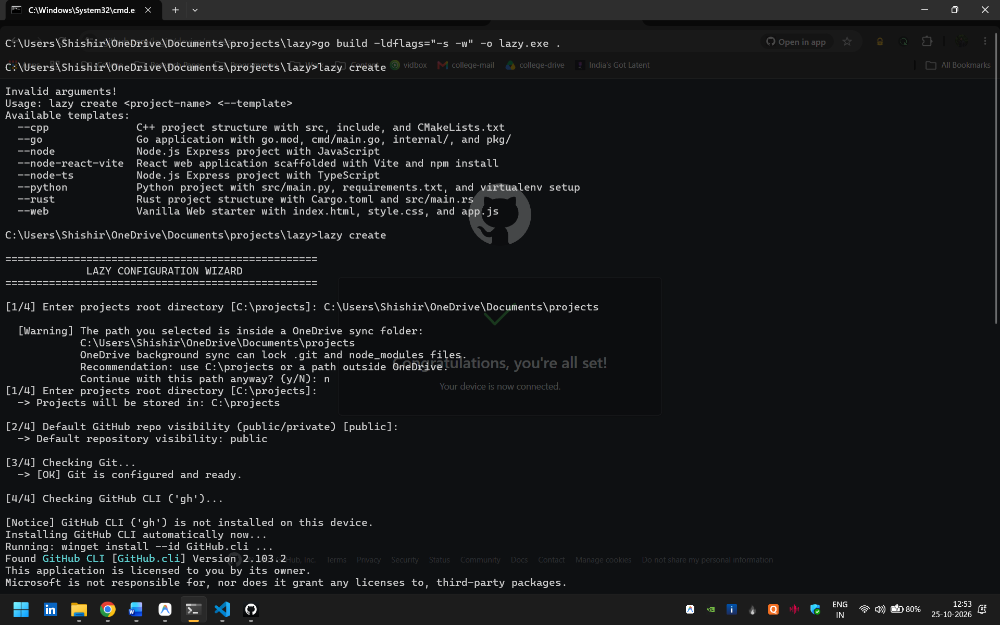
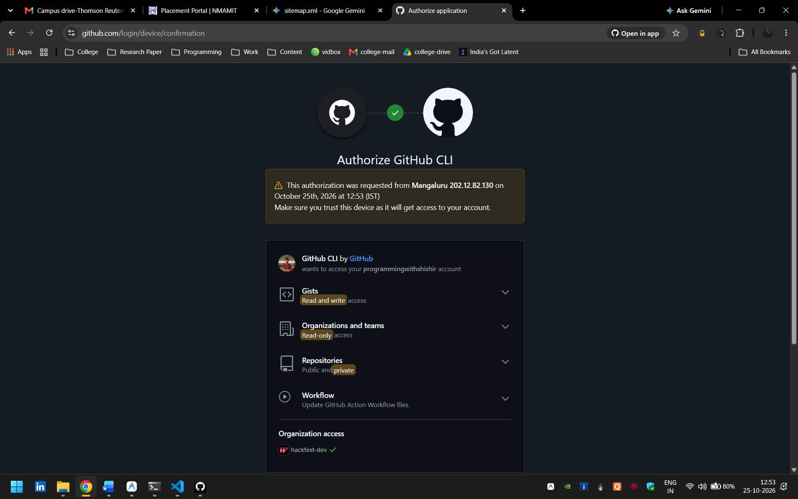
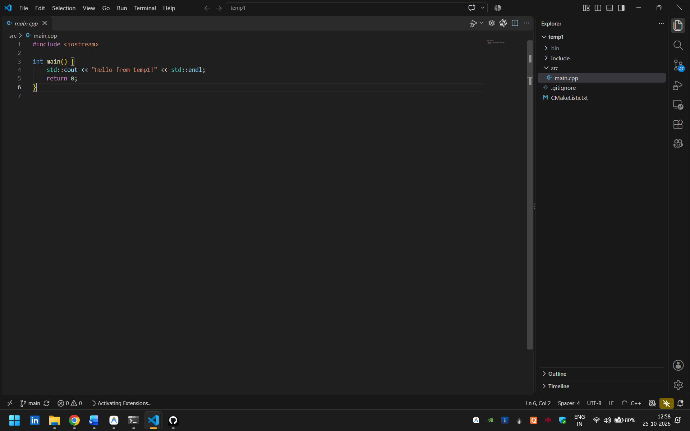
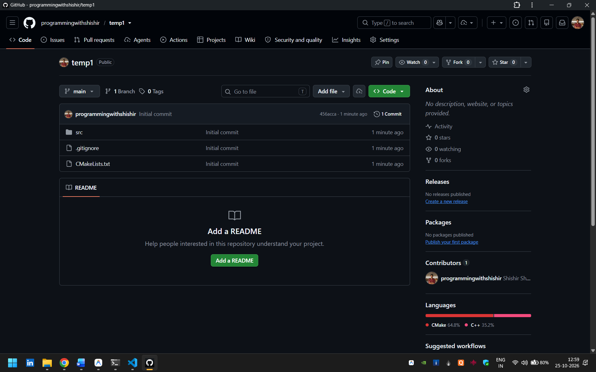

# 😴 Lazy

Lazy is a **universal project scaffolding CLI** written in Go for Windows 10+.
One command creates your project structure, initializes Git, provisions a GitHub repository, and opens your editor — all in one place.

```powershell
lazy create <project-name> <--recipe-flag>
```

---

## 📸 Screenshots

|  |
|:--:|

|  |  |  |
|:--:|:--:|:--:|

> 🖼️ Click on any image to view it in full size.

---

## ✨ Features

* ⚡ Scaffold a full project, local Git repo, and remote GitHub repo with a single command.
* 📦 **Zero external dependencies** — 100% Go standard library.
* 🔧 **Automatic dependency installation** for missing tools (Git, Node.js, Python, Go, Rust, CMake, GitHub CLI).
* 🔄 **Windows Registry `%PATH%` sync**, so freshly installed tools work in the same terminal session.
* 🛡️ **Atomic rollbacks** — if any step fails, partial folders and orphaned GitHub repos are cleaned up.
* 🔍 **Collision detection** for both local folders and remote GitHub repositories before anything is created.
* 🧙 Interactive first-run setup wizard with OneDrive sync warnings.
* 🚀 Opens the finished project in your code editor automatically.

---

## 🚀 Tech Stack

* **Language:** Go 1.24.1 (standard library only: `net/http`, `os/exec`, `encoding/json`, `bufio`, `path/filepath`)
* **Remote Provisioning:** GitHub CLI (`gh`)
* **Package Managers (auto-install tiers):** WinGet → Scoop / Chocolatey → direct silent `.msi` / `.exe` installers
* **Config Storage:** JSON (`%USERPROFILE%\.lazy\config.json`)
* **Platform:** Windows 10 and Windows 11

---

## 🧩 Supported Recipes

| Flag | Recipe | Prerequisites |
| :--- | :--- | :--- |
| `--cpp` | C++ with CMake (C++17) | CMake, `g++` / `clang++` / `cl.exe` |
| `--go` | Go module | Go |
| `--node` | Node.js Express (JavaScript) | Node.js, npm |
| `--node-ts` | Node.js Express (TypeScript) | Node.js, npm |
| `--node-react-vite` | React (Vite) | Node.js, npm |
| `--python` | Python 3 with virtualenv boilerplate | Python 3 |
| `--rust` | Rust with Cargo (2021 edition) | Rust, Cargo |
| `--web` | Vanilla HTML5 / CSS3 / JS | *None* |

Missing prerequisites are installed automatically.

---

## 🛠️ Setup Instructions

Clone the repository and get started!

```powershell
# 1. Clone the repo
git clone https://github.com/programmingwithshishir/lazy.git
cd lazy

# 2. Build the binary
go build -ldflags="-s -w" -o lazy.exe .

# 3. Run the first-time setup wizard
.\lazy.exe config
```

### Other ways to run

```powershell
# Run without compiling
go run . --help
go run . create sample-project --go

# Install globally to %USERPROFILE%\go\bin
go install .
```

> 💡 Make sure `%USERPROFILE%\go\bin` is in your system `PATH`. Then you can run `lazy` from any terminal.

---

## 📖 Usage

### Create a project

```powershell
lazy create auth-service --node-ts        # Node.js TypeScript API
lazy create dashboard-ui --node-react-vite # React frontend
lazy create game-engine --cpp             # C++ project
lazy create data-pipeline --python        # Python application
lazy create user-api --go                 # Go microservice
lazy create cli-tool --rust               # Rust application
lazy create landing-page --web            # Vanilla web page
```

### Commands

| Command | Purpose |
| :--- | :--- |
| `lazy create <name> <--recipe>` | Scaffold a new project |
| `lazy list` | List all projects in your configured directory |
| `lazy config` | Run the interactive setup wizard |
| `lazy config --show` | Show current settings and environment health |
| `lazy --help` | Show help and all registered recipes |

---

## ⚙️ Configuration

Settings are stored at `%USERPROFILE%\.lazy\config.json`:

```json
{
  "projects_path": "C:\\projects",
  "default_visibility": "public"
}
```

* **`projects_path`**: Root directory for all scaffolded projects (default `C:\projects`).
* **`default_visibility`**: GitHub repository visibility, `public` or `private`.

On first run of `lazy create` or `lazy list`, the setup wizard walks you through:

1. Choosing the projects directory (with a OneDrive conflict warning)
2. Setting default repository visibility
3. Verifying Git and configuring `user.name` / `user.email`
4. Installing and authenticating the GitHub CLI

---

## 🔄 How It Works

```
[Start]
  ├─► 1. Check recipe prerequisites (auto-install if missing)
  ├─► 2. Check name collisions (local folder & GitHub remote)
  ├─► 3. Create local project directory      [rollback: delete folder]
  ├─► 4. Run recipe scaffolding
  ├─► 5. Initialize Git & make initial commit
  ├─► 6. Create GitHub repo & push           [rollback: gh repo delete]
  └─► 7. Open project in code editor
[Success]
```

If any step fails, Lazy steps out of the project directory (avoiding Windows file locks) and removes everything it created, locally and on GitHub.

---

## 📁 Project Structure

```text
lazy/
├── config.go            # Config persistence & onboarding wizard
├── gh.go                # GitHub CLI detection, install, auth & collision checks
├── lazy.go              # Entry point, command dispatcher & transaction coordinator
├── system.go            # Windows safeguards: PATH reload, Git installer, identity setup
├── go.mod / go.sum
└── recipes/
    ├── recipes.go       # Recipe registry & interface
    ├── prerequisites.go # Prerequisite verifiers & auto-installers
    ├── cpp.go
    ├── go.go
    ├── node.go
    ├── python.go
    ├── react.go
    ├── rust.go
    └── web.go
```

---

## 🪟 Windows Safeguards

* **Registry PATH refresh:** reads `HKLM` and `HKCU` environment keys so new installs work immediately.
* **Reliable `msiexec` lookup:** falls back to hardcoded `System32` / `SysWOW64` paths.
* **Multi-tier installers:** works even on LTSC, Server, or locked-down corporate machines.
* **Git identity auto-config:** pulls name and noreply email from `gh api user` if unset.
* **OneDrive warning:** avoids `EPERM` / `EBUSY` errors from sync locking `node_modules` and `.git`.
